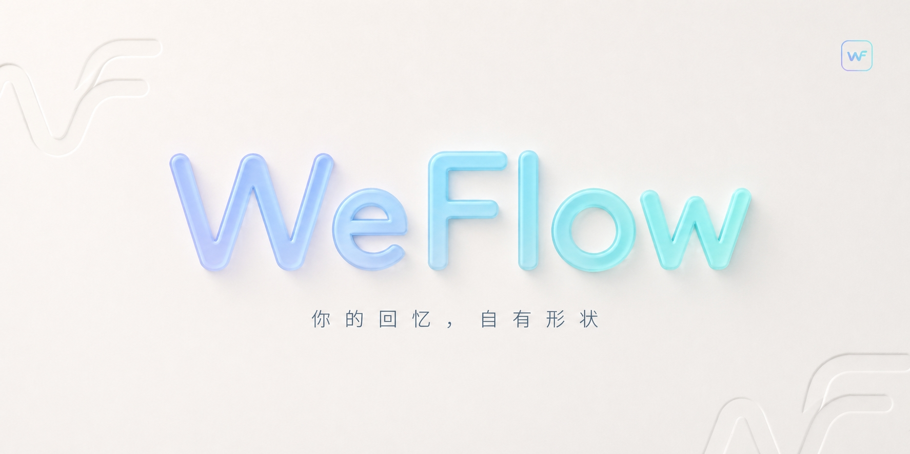
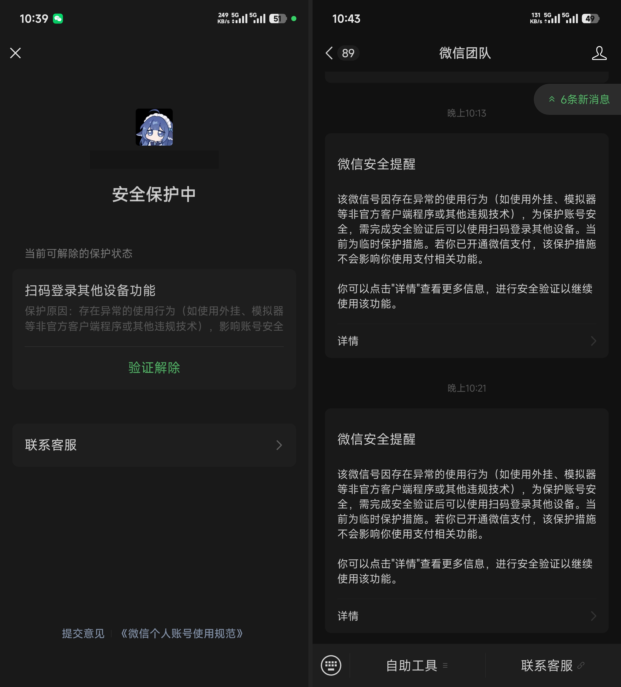

<p align="center">
  
</p>

# WeFlow

WeFlow 是一个**完全本地**的微信**实时**聊天记录查看、分析与导出工具。  
它可以获取你的微信聊天记录并将其导出，还可以根据你的聊天记录为你生成独一无二的数据与年度报告。

> [!WARNING]
> **本项目代码来源于网络收集，非本人开发，仅作备份与分享。**
>
> 原项目地址：[https://github.com/hicccc77/WeFlow](https://github.com/hicccc77/WeFlow)
>
> 本仓库版权归原作者所有，请尊重原作者劳动成果。
>
> 本修改项源码来源：[https://github.com/mjkyleo/weflow](https://github.com/mjkyleo/weflow)

> [!CAUTION]
> **郑重声明：本项目仅供学习、研究和参考，严禁实际使用。**
>
> 请勿将本项目或其编译版本用于登录、读取、分析、导出或修改任何真实微信账号及聊天记录，也不要用于商业、生产或其他实际场景。

本项目是**非官方、非商业用途的兼容修复测试版**，与原作者及其团队没有官方关联，也不代表其立场或支持。上方产品简介引用原项目描述，并非本修改版已完成所有功能、安全性或网络行为核验的保证。

## 微信账号安全风险

**使用此类第三方工具可能被微信官方的安全机制识别为异常使用行为，并可能触发安全验证、设备登录限制或其他账号保护措施。** 请勿对真实账号使用本项目。

下方截图记录了账号收到的微信安全提醒及保护状态，提示中列举了非官方客户端等可能涉及的异常行为。截图**未直接指出本项目或具体触发原因**，因此不能仅凭截图断定官方已识别出本软件，或断定每次使用都会触发限制。截图保留了头像，账号标识已遮挡。



本次修复针对特定 Windows x64 版本的 `wcdb_api.dll`（动态链接库）在到期后返回 `-101` 的问题。它不是通用于所有 WeFlow 版本的补丁，也不是 6.3.1 组件的修复包。

## 版本和来源

- 基础工程是原项目的社区镜像备份；镜像的 `package.json` 标记版本为 `5.0.0`，因此本地构建安装包也显示 `5.0.0`。
- 镜像仓库的提交说明将该快照称为“5.1.0 源码备份”。目前不能仅凭包版本号断言它与官方某个完整源码发布版本完全一致。
- 修复的 Windows x64 DLL 与用于排查的 `WeFlow-5.1.0-x64-Setup.exe` 中对应 DLL 的 SHA-256（文件指纹）一致。修复只针对这份确定的二进制组件。
- 原镜像保留的说明见 [README.upstream.md](README.upstream.md)。本仓库包含原生预编译组件，**不包含 `wcdb_api.dll` 的原生实现源码**，不能声称整套软件均可从源码重建。

## 改动概览

在指定的 `wcdb_api.dll` 中，确认有两处与运行期限相关的时间常量：一处导致初始化返回 `-101`，另一处在数据库初始化阶段参与到期判断。修复在已校验文件指纹和原始字节的前提下，将这两处期限延至 2037 年。未把面向 6.3.1 的第三方 DLL 放进此版本。

为了与原安装隔离，测试版使用独立应用标识和 `%APPDATA%\WeFlow-Repair-Test` 配置目录，并禁用自动更新；主程序仍名为 `WeFlow.exe`。安装脚本不再联网下载运行库，所需运行库按项目配置随包提供。具体变更、文件指纹和验证范围见 [修复记录](docs/repair-details.md)。

## 研究材料

仓库及其配套材料仅供学习、研究和参考，**严禁实际使用**。如发布者提供用于研究的 Windows x64 构建文件，其名称为：

`WeFlow-5.1-compatible-repair-test-x64-Setup.exe`

此构建**没有发布者数字签名**，不应被用于实际操作。仅为核对研究材料的完整性，可在 PowerShell（命令行）中计算 SHA-256：

```powershell
Get-FileHash -Algorithm SHA256 -LiteralPath .\WeFlow-5.1-compatible-repair-test-x64-Setup.exe
```

本次验证的安装包指纹为：

```text
23D82FB1FBD3B802CE6915C68C6779ECCC490A80BF586D2B6190EB5ACCA5C331
```

该值只对应本次提供的安装包；后续重新构建时应重新计算，不能照搬。

## 验证范围

在关闭网络的 Windows 沙盒中，安装器返回成功，应用进程启动并创建独立配置目录；数据库工作线程成功初始化、打开合成空数据库、执行固定值查询并关闭。原安装包的工作线程在修复组件下还通过了新进程中的重复连接和查询测试。合成数据库没有真实聊天表。

使用者另反馈该版本在其电脑上解决了所遇问题；该反馈没有逐项记录功能范围。真实数据库的完整兼容性、图片、语音、导出、升级卸载和正常托盘退出重启仍未逐项验证，请见 [修复记录](docs/repair-details.md)。

## 本地构建

在 Windows x64 上准备与项目依赖兼容的 Node.js（JavaScript 运行环境）和 npm（软件包管理器），然后在源码目录执行：

```powershell
npm ci
npm run build -- --win nsis --x64 --publish never
```

实际构建会下载 Electron（桌面应用运行环境）及打包依赖，需要网络。构建结果默认在 `release/`；不同环境、依赖或签名条件会导致输出指纹不同。源码包保留依赖锁文件，但没有证明完整构建逐字节可复现。

## 许可与发布前核查

镜像中保留的 [LICENSE](LICENSE) 为 Creative Commons Attribution-NonCommercial-ShareAlike 4.0 International（署名-非商业性使用-相同方式共享 4.0 国际许可，CC BY-NC-SA 4.0）。分享修改内容时请保留原作者署名、来源、许可、免责声明与修改说明，遵守非商业及相同方式共享条件。许可文本与说明不构成法律意见。

安装包及源码中的预编译 DLL、运行库、字体、第三方包等可能受各自许可或其他权利约束；`wcdb_api.dll` 的原始构建来源和完整再分发授权尚未核实。**公开发布二进制文件之前，应先核查各组件的来源、许可证、修改与再分发权限**，必要时取得权利人许可。不得将本版本表述为官方发布或已获原作者背书。

本项目涉及敏感的本地聊天数据。报告问题时请删除账号标识、密钥、聊天内容及用户路径，不要公开上传数据库或完整日志。
